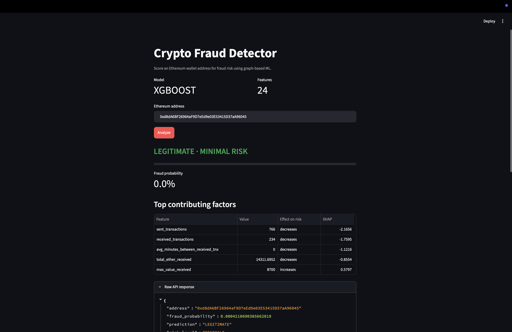

# crypto-fraud-detector

   

Detect fraudulent Ethereum wallet addresses using graph-based feature engineering and machine learning classifiers.

Given an Ethereum address, the system analyzes its transaction history, builds a local transaction graph, extracts structural and statistical features, and returns a fraud risk score with explanations.

## Demo

The dashboard scores a live address end to end: it calls the API, which fetches the address's transactions from Etherscan, extracts 24 features, runs the XGBoost model, and returns a risk score with SHAP explanations.



*Scoring `0xd8dA...96045` (vitalik.eth): LEGITIMATE, 0.0% fraud probability. High transaction counts lower the fraud score, which matches real behavior: fraud wallets tend to transact briefly then abandon the address.*

## Why this exists

Blockchain fraud (wash trading, phishing, pump-and-dump schemes) costs billions annually. Tools like Chainalysis and Elliptic solve this at enterprise scale. This project demonstrates the same core approach at a portfolio scale: collect on-chain data, engineer meaningful features from transaction graphs, and train classifiers that distinguish fraudulent wallets from legitimate ones.

## Architecture

```
┌─────────────┐     ┌──────────────────┐     ┌──────────────┐
│  Etherscan   │────>│  Data Collector   │────>│  Raw Data    │
│  API         │     │  (rate-limited)   │     │  (CSV/JSON)  │
└─────────────┘     └──────────────────┘     └──────┬───────┘
                                                     │
                    ┌──────────────────┐              │
                    │  Feature Engine   │<────────────┘
                    │                  │
                    │  - Transaction   │
                    │  - Graph (NX)    │
                    │  - Statistical   │
                    └───────┬──────────┘
                            │
                    ┌───────v──────────┐
                    │  ML Pipeline     │
                    │                  │
                    │  - Random Forest │
                    │  - XGBoost       │
                    │  - SHAP explain  │
                    └───────┬──────────┘
                            │
              ┌─────────────┴─────────────┐
              │                           │
      ┌───────v────────┐         ┌────────v───────┐
      │  FastAPI        │         │  Streamlit     │
      │  REST API       │         │  Dashboard     │
      │                │         │                │
      │  POST /predict │         │  - Risk score  │
      │  GET /health   │         │  - SHAP table  │
      └────────────────┘         │  - SHAP chart  │
                                 └────────────────┘
```

## Features

**Transaction features**: total sent/received, average value, min/max value, transaction frequency, time span of activity.

**Graph features**: in-degree, out-degree, clustering coefficient, PageRank, self-loop detection, circular path detection, community membership (Louvain).

**Statistical features**: value distribution skewness/kurtosis, burst detection (sudden activity spikes), ratio of unique counterparties to total transactions.

## Tech stack

| Layer              | Tools                                      |
|--------------------|---------------------------------------------|
| Data collection    | Etherscan API, Kaggle dataset               |
| Data processing    | pandas, NumPy                               |
| Graph analysis     | NetworkX                                    |
| ML training        | scikit-learn, XGBoost                       |
| Explainability     | SHAP                                        |
| API                | FastAPI, Pydantic                           |
| Dashboard          | Streamlit, Plotly                            |
| Deployment         | Docker, Docker Compose                      |
| Testing            | pytest                                      |

## Project structure

```
crypto-fraud-detector/
├── src/
│   ├── collector/          # Etherscan API client, dataset loaders
│   ├── features/           # Feature engineering (transaction, graph, statistical)
│   ├── models/             # Training, evaluation, inference
│   ├── api/                # FastAPI REST endpoints
│   └── dashboard/          # Streamlit interactive dashboard
├── notebooks/              # Exploration and analysis notebooks
├── tests/                  # Unit tests
├── data/                   # Raw and processed data (gitignored)
├── models/                 # Trained model artifacts (gitignored)
├── docs/                   # Architecture and design notes
├── Makefile                # Common commands (make train, make api, etc.)
├── requirements.txt
├── Dockerfile
├── docker-compose.yml
└── .env.example
```

## Setup

### Prerequisites

- Python 3.11+
- Free Etherscan API key ([etherscan.io/apis](https://etherscan.io/apis))

### Install

```bash
git clone https://github.com/reynaldusjasona/crypto-fraud-detector.git
cd crypto-fraud-detector

python -m venv venv
source venv/bin/activate   # Windows: venv\Scripts\activate

pip install -r requirements.txt

cp .env.example .env
# Edit .env and add your ETHERSCAN_API_KEY
```

### Run

```bash
# Collect data
make collect

# Train model
make train

# Start the API server (keep this running)
make api

# In a second terminal, launch the dashboard
make dashboard
# then open http://localhost:8501
```

### Docker

```bash
docker compose up --build
```

## API

With the server running (`make api`), interactive docs are at `http://localhost:8000/docs`.

| Method | Endpoint      | Description                                  |
|--------|---------------|----------------------------------------------|
| GET    | `/health`     | Liveness check and whether the model is loaded |
| GET    | `/model/info` | Model type, feature list, and evaluation metrics |
| POST   | `/predict`    | Score an address. Body: `{"address": "0x..."}` |

Example:

```bash
curl -X POST http://localhost:8000/predict \
  -H "Content-Type: application/json" \
  -d '{"address": "0xd8dA6BF26964aF9D7eEd9e03E53415D37aA96045"}'
```

## Testing

```bash
pytest -v                               # run all tests
pytest --cov=src --cov-report=term-missing   # with coverage
```

29 tests cover the feature engineering, data cleaning, Etherscan client (HTTP mocked), and API endpoints. Core logic coverage: `transaction.py` 100%, `graph.py` and `statistical.py` 85%, API 86%. The training script, dashboard UI, and live Etherscan path are excluded by design.

## Data sources

1. **Ethereum Fraud Detection Dataset** (Kaggle): ~10K labeled addresses (fraud/legitimate) with pre-computed transaction features. Used for initial model training.
2. **Etherscan API** (free tier, 5 req/sec): live transaction history lookup for scoring new addresses.

## Model performance

Trained on the Kaggle Ethereum Fraud Detection dataset (9,841 labeled addresses). XGBoost is the selected model.

| Model          | Precision | Recall | F1     | AUC-ROC |
|----------------|-----------|--------|--------|---------|
| Random Forest  | 0.904     | 0.860  | 0.881  | 0.982   |
| XGBoost        | 0.929     | 0.869  | 0.898  | 0.985   |

## Roadmap

- [x] Project scaffold and repo setup
- [x] Data collection pipeline (Etherscan API client + Kaggle loader)
- [x] Feature engineering (transaction, graph, statistical)
- [x] Model training and evaluation
- [x] FastAPI REST API
- [x] Streamlit dashboard
- [ ] Expand test coverage (collector, features, models)
- [ ] Graph visualization in dashboard
- [ ] Deploy dashboard to Streamlit Cloud

## License

MIT
